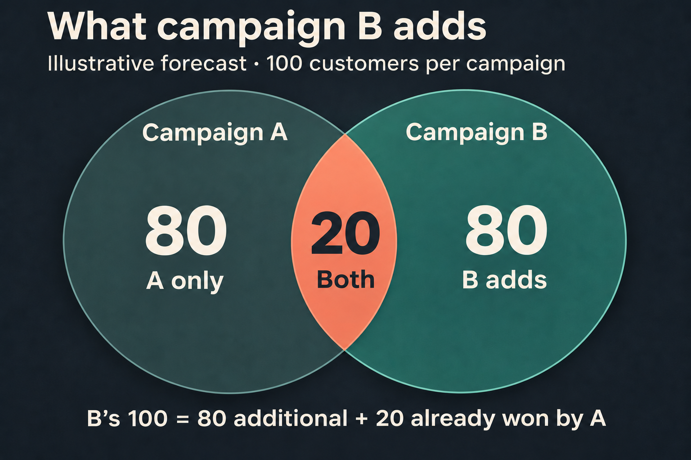
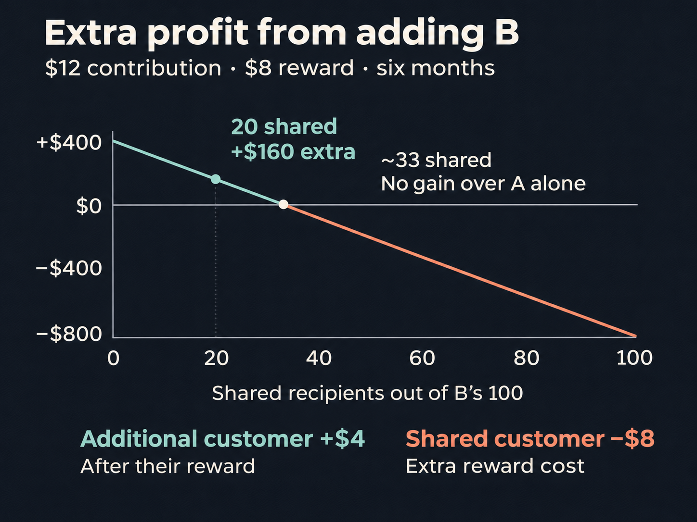

Offer me $8 for trying your card and $8 for trying your wallet, and I’m putting the card in the wallet. I’ll pay for the groceries once and collect both.

I can picture that screenshot arriving in the budget chat. I might still approve the campaigns.

Give each campaign a forecast of 100 customers. Twenty are the same people, who would join with either offer. The other 80 in each group need that particular offer. Assume a new customer brings the financial group $12 of contribution over six months, after other variable costs and before rewards. Paying both bonuses leaves the shared customers’ expected activity unchanged.

Running A alone earns $400 after its bonuses. Adding B brings 80 genuinely additional customers, worth $4 each after their $8 reward. That’s $320. The 20 shared customers cost another $8 apiece, or $160, for business A already wins.

I’m left with $160 of additional profit. The two campaigns together earn $560 against $400 from A alone. I can approve that and still be irritated by the duplicate payouts.

For the shared customer, the second payment costs the full $8. Their combined profit is now minus $4, but we could already earn plus $4 from them with A. That $8 deterioration is what the new customers have to pay for.

At these margins, I need more than two additional customers for every shared one. With 100 bonus recipients in B, the extra profit disappears at roughly 33 shared customers. Twenty gives me room. Thirty leaves just $40. That’s a very different proposal to take into the same budget meeting.

That limit depends on what the additional customers are worth. At $10 each before rewards, the break-even point falls to 20 shared recipients out of 100.

I’d still ask whether we can avoid paying the second bonus. A reliable exclusion that preserves the additional customers saves $160 here. I’d weigh that saving against implementation costs and the contribution lost to extra friction.

The number I’d argue about hardest is 80. It has to mean customers we would otherwise miss. Finding an ID only in B’s report tells me where we recorded that customer. I also need a credible estimate of what they’d have done with A running on its own.

Where possible, I’d leave A running and randomly withhold B from part of the eligible group. I’d compare group contribution over the same period. A lift in wallet activations is useful context. The budget needs the extra value left after the extra rewards.

Before that evidence exists, the proposal has a forecast. I’d want a range for the shared and additional customers, including a version where B reaches more people A would win anyway. A forecast that barely clears the line would get a smaller first commitment from me. I’m more comfortable paying for overlap when the plan has room to absorb a mistake about who is really new.

The double-bonus screenshot belongs in the review. So does the customer who would have stayed with another provider if we’d cancelled B.

*All figures are illustrative. Customer groups describe assumed responses to the offers. Shared customers bring no additional contribution from receiving both. Costs and value use the same six-month window.*
